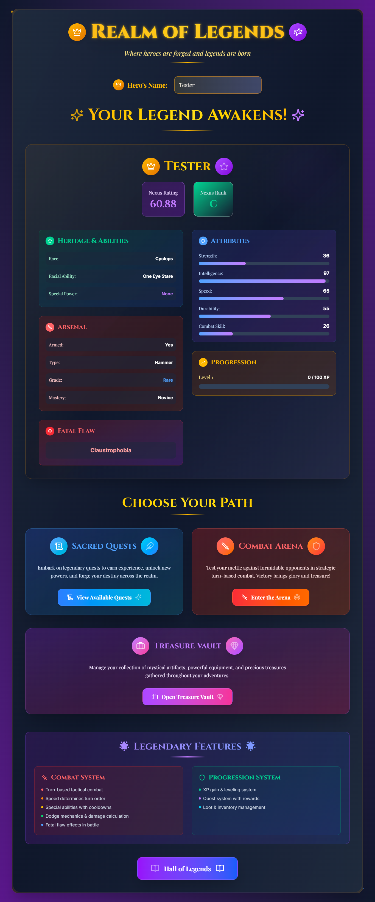
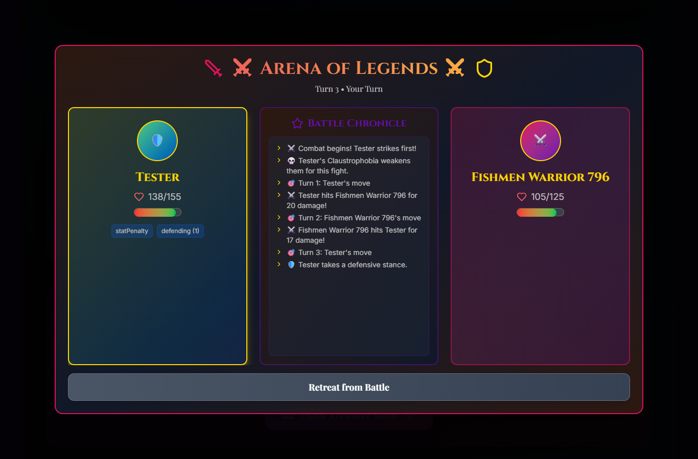

# Realm of Legends

A browser fantasy RPG built with React. Every character is rolled on a wheel of fate (race, powers, weapon and a fatal flaw), then fights AI opponents in turn-based combat to earn XP, loot and quest rewards.



## Gameplay

**Character creation.** Name your hero and spin for each trait in turn: race, racial ability, weapon (type, grade, mastery), special ability and fatal flaw, then five rolled stats (Strength, Intelligence, Speed, Durability, Combat Skill). The result is scored as a **Nexus Rating** (0–100) and a letter **Nexus Rank**.

**Combat.** Turn-based fights against a generated opponent near your rank.
- Speed decides who strikes first.
- **Attack**: physical damage from Strength, weapon and mastery, reduced by the defender's Durability; the defender may dodge.
- **Defend**: reduces damage taken until your next turn.
- **Abilities**: 24 special abilities (damage, healing, shields, stuns, revive and more) with cooldowns and per-match use limits.
- Fatal flaws apply in battle: self-damage, forced attacks, failed abilities, permanent stat penalties.
- The opponent AI chooses between attacking, defending and its own ability based on health.

**Progression.** Wins grant XP (with level-ups) and randomly weighted loot by rarity; losses cost a little XP. Battle quests send matching enemies to the arena and pay out XP and items on completion. Items are kept in the Treasure Vault.

**Saving.** Progress is saved automatically, in the browser by default or to Firebase if configured.



## Tech stack

| | |
|---|---|
| UI | React 19, Tailwind CSS 4, Lucide icons |
| Build | Vite 6 (SWC), ESLint 9 |
| Persistence | `localStorage`, or Firebase Anonymous Auth + Cloud Firestore (optional, lazy-loaded) |
| Deploy | GitHub Actions → GitHub Pages |

## Running locally

Requires Node.js 18 or newer.

```bash
npm install
npm run dev        # http://localhost:5173
```

Production build:

```bash
npm run build
npm run preview    # serves dist/
```

### Optional: Firebase saves

Without configuration the game stores characters in the browser. To save them to Firebase instead, copy `.env.example` to `.env`, fill in your project's web config, and enable **Anonymous** sign-in and **Cloud Firestore** in the Firebase console.

## Project structure

```
src/
├── App.jsx                  game state, progression, quests, rewards
├── gameData.js              races, abilities, weapons, flaws, items, quests
├── components/
│   ├── CharacterGenerator.jsx   wheel-of-fate character creation
│   ├── CharacterSummary.jsx     character sheet
│   ├── CombatArena.jsx          turn-based combat engine and AI
│   ├── GameActions.jsx          quests / arena / vault menu
│   ├── QuestsModal.jsx
│   ├── InventoryModal.jsx
│   └── RankingsModal.jsx
├── services/storage.js      localStorage / Firebase persistence
└── utils/helpers.js         random and weighted-random helpers
```

## Status

Battle quests are playable. The other quest templates in `gameData.js` (exploration, stat training, ability trials, flaw redemption) are defined but not yet offered in game.

